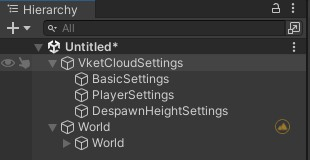
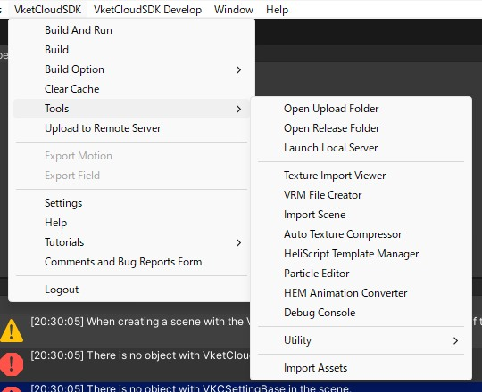
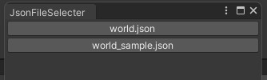
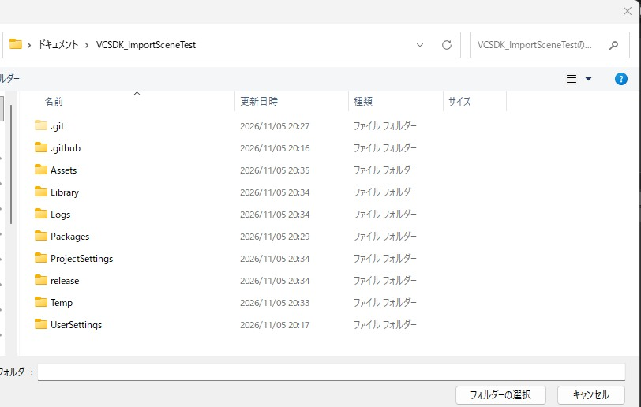
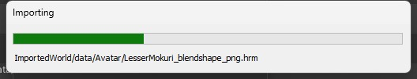
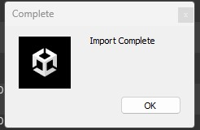
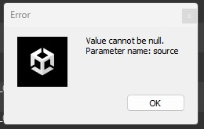
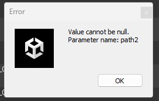

# Import Scene

## Overview

Import Scene loads built world data (the world JSON and related files in the `release` folder) into your Unity project and restores it as a Unity scene.

The following are imported:

- World settings (Vket Cloud Setting: world name, camera, avatar, rendering, my avatar, etc.)
- HEO objects and fields listed in the world JSON (placed as children of the `World` object)
- Despawn area settings
- The avatar, field, image, motion and GUI files used by the above (copied into the folder you select)

!!! note
    Items other than HEO objects (such as lights) and spawn points (`spawns`) are not imported.

## Prerequisites

Make sure the following conditions are met before importing.

| Condition | Details |
| ---- | ---- |
| The `release` folder exists | The `release` folder directly under the Unity project (the same level as `Assets`) is used. |
| A world JSON exists | At least one `*.json` file is required directly under `release/data/Scene/`. |
| Required folders exist | `release/data/` must contain all five folders: `Avatar`, `Field`, `Image`, `motion` and `gui`. If any is missing, copying the files fails. |
| The destination is inside `Assets` | Select a folder **inside** the `Assets` folder. |
| The world JSON is valid | The JSON must contain `rendering`, `camera`, `physics`, `voiceattenuation`, `myavatar`, `scripts`, `avatars` and `dummyavatars`. In addition, `myavatar` and each element of `avatars` need `emotions` (an empty array `[]` is fine), and each element of `avatars` needs `filename` (the avatar file path). |
| `AreaColliderForDespawn` exists | The imported HEO must contain an object named `AreaColliderForDespawn`. |

## How to Use

### 1. Open the menu

From the Unity menu bar, select Vket Cloud SDK > Tools > Import Scene.

### 2. Select a JSON file

If `release/data/Scene/` contains only one JSON file, this step is skipped and you proceed to step 3.

If there are multiple JSON files, a window with a button for each file name opens. Click the button of the JSON you want to import.

### 3. Select the destination folder

A "Select Folder" dialog opens. Select the folder the files will be copied into.

!!! warning
    - Always select a folder **inside** the `Assets` folder. Selecting a folder outside `Assets` results in an error.
    - Selecting the `Assets` folder itself makes the copy fail. Create a subfolder such as `Assets/ImportedWorld` beforehand and select it.

### 4. Run the import

When you select a folder, the import starts and a progress bar is displayed. The following steps are performed in order:

1. `Avatar`, `Field`, `Image`, `motion` and `gui` in `release/data` are copied into the `data` folder inside the selected folder. Files that already exist at the destination are skipped, not overwritten. `.meta`, `.bat`, `.gitkeep` and `.sh` files are not copied.
2. A `VketCloudSetting` is created if the scene does not have one.
3. The contents of the world JSON are applied to `VketCloudSetting`.
4. HEO objects and fields are loaded as children of the `World` object.
5. The despawn area is set.

### 5. Completion

When the "Import Complete" dialog appears, the import is finished. A `World` object is created in the Hierarchy, and the imported HEOs are placed under it.

## Troubleshooting

| Symptom | Cause and solution |
| ---- | ---- |
| Nothing happens when selecting the menu | The `release/data/Scene/` folder does not exist, or it contains no `*.json` file. Check the Console for errors or warnings. Build the world first to create the `release` folder. |
| An error dialog appears right after "Select Folder" | A folder outside `Assets` was selected. Select a folder inside `Assets`. In the current version, the dialog body shows the key name `ImportProcessSystem_Folder_Select_Error` instead of a sentence. |
| `{file name} not found` | The selected JSON was not found in `release/data/Scene/`. |
| Failed to read the JSON (`WorldJsonSerializeError`) | The JSON format is invalid. Check the message in the dialog. |
| Failed to copy files (`FileCopyError`) | One of `Avatar`, `Field`, `Image`, `motion` or `gui` is missing in `release/data/`, or the `Assets` folder itself was selected as the destination. |
| An error occurred during import (`ImporttingError`) | The JSON lacks required items (such as `rendering` or `camera`), or the imported HEO does not contain `AreaColliderForDespawn`. |
| "Value cannot be null. Parameter name: source" | `emotions` is missing in `myavatar` or `avatars` in the JSON.  Add `"emotions": []`. |
| "Value cannot be null. Parameter name: path2" | `filename` is missing in each element of `avatars` in the JSON (this happens when only `filename_png`, `filename_astc` and `filename_etc2` are output).  Add `filename` with the avatar file path (e.g. `Avatar/UrbanStyle_png.hrm`). |

!!! warning
    JSON files output by building a world with the current version lack `emotions` and the `filename` of `avatars`, so the import fails as is (the two errors above). Add the items above to the JSON you import.

!!! note
    Processing stops when an error occurs, but files that were already copied are not deleted. Before retrying, check the contents of the destination folder.
