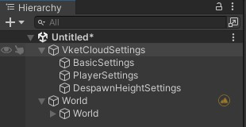
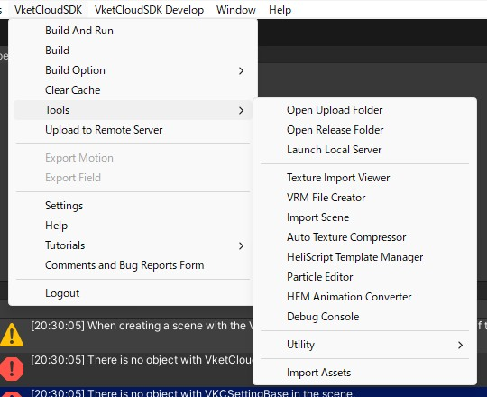
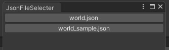
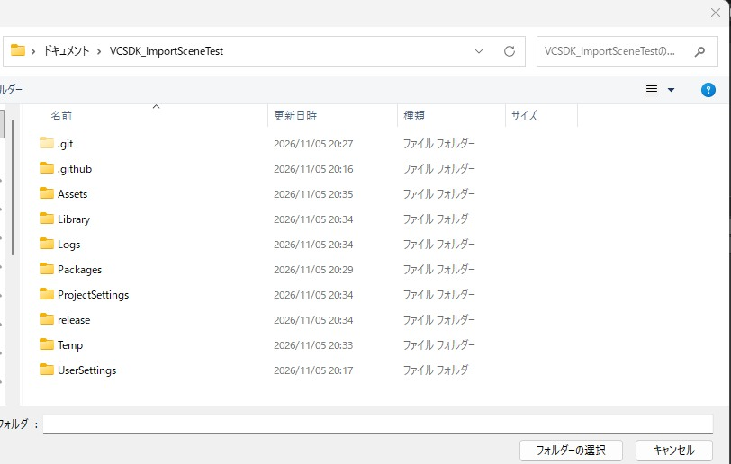
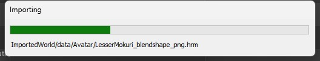
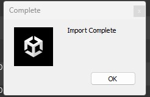
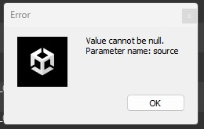
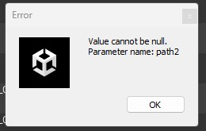

# シーンのインポート (Import Scene)

## 概要

シーンのインポートは、ビルド済みのワールドデータ（`release`フォルダ内のワールドJSONと関連ファイル）をUnityプロジェクトに読み込み、Unity上のシーンとして復元するツールです。

以下の内容がインポートされます。

- ワールド設定（Vket Cloud Setting：ワールド名、カメラ、アバター、レンダリング、マイアバターなど）
- ワールドJSONに記載されたHEOのオブジェクト・フィールド（`World`オブジェクトの子として配置されます）
- Despawnエリアの設定
- 上記で使われるアバター・フィールド・画像・モーション・GUIなどのファイル（選択したフォルダ内にコピーされます）

!!! note
    ライトなどのHEOオブジェクト以外のアイテムや、スポーン地点（`spawns`）はインポートされません。

## インポートの前提条件

インポートを行う前に、以下の条件を満たしていることを確認してください。

| 条件 | 内容 |
| ---- | ---- |
| `release`フォルダが存在する | Unityプロジェクト直下（`Assets`フォルダと同じ階層）の`release`フォルダを参照します。 |
| ワールドJSONが存在する | `release/data/Scene/`の直下に`*.json`ファイルが1つ以上必要です。 |
| 必要なフォルダが揃っている | `release/data/`の中に`Avatar`、`Field`、`Image`、`motion`、`gui`の5つのフォルダが必要です。1つでも欠けていると、ファイルのコピーに失敗します。 |
| 保存先が`Assets`の配下 | 保存先は`Assets`フォルダの**中にあるフォルダ**を選択してください。 |
| ワールドJSONの形式が正しい | `rendering`、`camera`、`physics`、`voiceattenuation`、`myavatar`、`scripts`、`avatars`、`dummyavatars`の各項目を含むJSONが必要です。 さらに、`myavatar`と`avatars`の各要素に`emotions`（空配列`[]`でも可）が必要です。また、`avatars`の各要素に`filename`（アバターのファイルパス）が必要です。 |
| `AreaColliderForDespawn`がある | 読み込まれるHEOの中に`AreaColliderForDespawn`という名前のオブジェクトが含まれている必要があります。 |

## 使用方法

### 1. メニューを開く

Unity上部のメニューから、Vket Cloud SDK > Tools > シーンのインポート (Import Scene) を選択します。

### 2. JSONファイルを選択する

`release/data/Scene/`にあるJSONファイルが1つの場合、この手順は省略され、手順3に進みます。

JSONファイルが複数ある場合は、ファイル名のボタンが並んだウィンドウが開きます。インポートしたいJSONのボタンをクリックしてください。

### 3. 保存先フォルダを選択する

「フォルダを選択」ダイアログが開きます。ファイルのコピー先となるフォルダを選択してください。

!!! warning
    - 必ず`Assets`フォルダの**配下**のフォルダを選択してください。`Assets`の外のフォルダを選ぶとエラーになります。
    - `Assets`フォルダそのものを選ぶとコピーに失敗します。`Assets/ImportedWorld`のように、あらかじめサブフォルダを作成してから選択してください。

### 4. インポートの実行

フォルダを選択するとインポートが始まり、プログレスバーが表示されます。次の順番で処理されます。

1. `release/data`内の`Avatar`、`Field`、`Image`、`motion`、`gui`を、選択したフォルダ内の`data`フォルダにコピーします。すでに同名のファイルがある場合は上書きせずスキップされます。`.meta`、`.bat`、`.gitkeep`、`.sh`ファイルはコピーされません。
2. シーン内に`VketCloudSetting`がなければ新しく作成します。
3. ワールドJSONの内容を`VketCloudSetting`に反映します。
4. HEOのオブジェクト・フィールドを`World`オブジェクトの子として読み込みます。
5. Despawnエリアを設定します。

### 5. 完了

「Import Complete」のダイアログが表示されたら完了です。Hierarchyに`World`オブジェクトが作成され、その子にインポートされたHEOが配置されます。

## エラーが出たときは

| 症状 | 原因と対処 |
| ---- | ---- |
| メニューを選んでも何も起きない | `release/data/Scene/`フォルダが存在しないか、フォルダ内に`*.json`がありません。ConsoleにエラーまたはWarningが出ていないか確認してください。先にワールドのビルドを行い、`release`フォルダを作成してください。 |
| 「Select Folder」の直後にエラーダイアログが出る | `Assets`の外のフォルダを選択しています。`Assets`配下のフォルダを選択してください。 現在のバージョンでは、ダイアログの本文が文章ではなく`ImportProcessSystem_Folder_Select_Error`というキー名で表示されます。 |
| `{ファイル名} not found` | 選択したJSONが`release/data/Scene/`に見つかりません。 |
| JSONの読み込みに失敗した（`WorldJsonSerializeError`） | JSONの形式が正しくありません。ダイアログのメッセージを確認してください。 |
| ファイルのコピーに失敗した（`FileCopyError`） | `release/data/`に`Avatar`、`Field`、`Image`、`motion`、`gui`のいずれかが無いか、保存先に`Assets`フォルダそのものを選択しています。 |
| インポート中にエラーが出た（`ImporttingError`） | JSONに必要な項目（`rendering`、`camera`など）が無いか、読み込んだHEOに`AreaColliderForDespawn`が含まれていません。 |
| 「Value cannot be null. Parameter name: source」 | JSONの`myavatar`または`avatars`に`emotions`がありません。  `"emotions": []`を追加してください。 |
| 「Value cannot be null. Parameter name: path2」 | JSONの`avatars`の各要素に`filename`がありません（`filename_png`、`filename_astc`、`filename_etc2`のみ出力されている場合に発生します）。  `filename`にアバターファイルのパス（例：`Avatar/UrbanStyle_png.hrm`）を追加してください。 |

!!! warning
    現在のバージョンでビルドしたワールドから出力されたJSONは、`emotions`と`avatars`の`filename`が含まれないため、そのままではインポートに失敗します（上記2つのエラー）。インポートするJSONには、上記の項目を追加してください。

!!! note
    エラーが発生した時点で処理は中断されますが、それまでにコピーされたファイルは削除されません。やり直す場合は、コピー先のフォルダの内容を確認してから再度実行してください。
